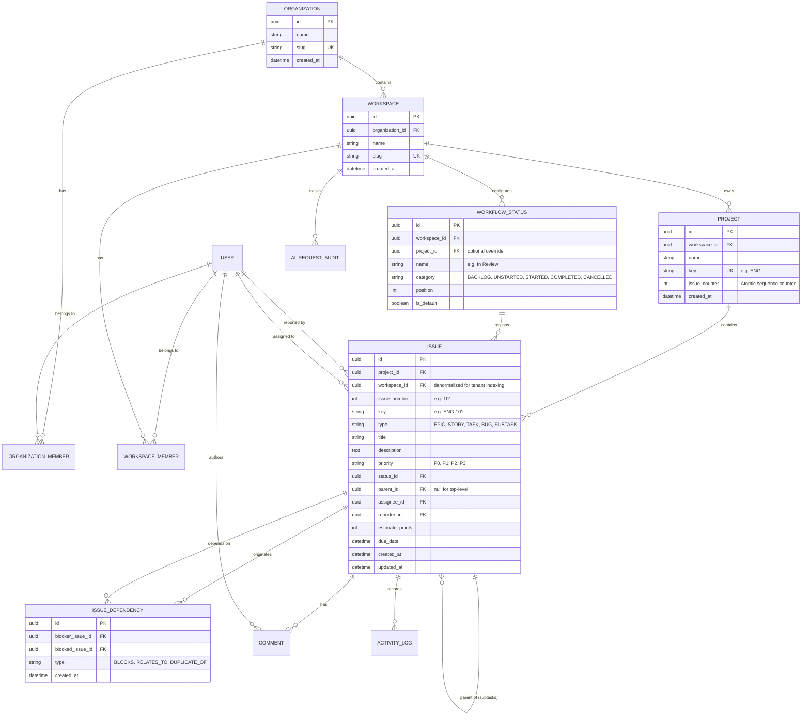

# Workflow AI — Domain Data Model Specification

## 1. Entity-Relationship Diagram (ERD)



---

## 2. Core Relational Schemas & Constraints

### 2.1 Multi-Tenancy (Organizations & Workspaces)
```prisma
model Organization {
  id          String   @id @default(uuid())
  name        String
  slug        String   @unique
  createdAt   DateTime @default(now())
  updatedAt   DateTime @updatedAt

  workspaces  Workspace[]
  members     OrganizationMember[]

  @@map("organizations")
}

model OrganizationMember {
  id             String       @id @default(uuid())
  organizationId String
  userId         String
  role           String       @default("member") // owner, admin, member
  createdAt      DateTime     @default(now())

  organization   Organization @relation(fields: [organizationId], references: [id], onDelete: Cascade)
  user           User         @relation(fields: [userId], references: [id], onDelete: Cascade)

  @@unique([organizationId, userId])
  @@map("organization_members")
}

model Workspace {
  id             String   @id @default(uuid())
  organizationId String
  name           String
  slug           String   @unique
  createdAt      DateTime @default(now())
  updatedAt      DateTime @updatedAt

  organization   Organization      @relation(fields: [organizationId], references: [id], onDelete: Cascade)
  members        WorkspaceMember[]
  projects       Project[]
  statuses       WorkflowStatus[]
  issues         Issue[]

  @@index([organizationId])
  @@map("workspaces")
}

model WorkspaceMember {
  id          String    @id @default(uuid())
  workspaceId String
  userId      String
  role        String    @default("member") // admin, member, viewer
  createdAt   DateTime  @default(now())

  workspace   Workspace @relation(fields: [workspaceId], references: [id], onDelete: Cascade)
  user        User      @relation(fields: [userId], references: [id], onDelete: Cascade)

  @@unique([workspaceId, userId])
  @@index([userId])
  @@map("workspace_members")
}
```

### 2.2 Projects & Atomic Concurrency-Safe Issue Numbering
```prisma
model Project {
  id           String   @id @default(uuid())
  workspaceId  String
  name         String
  key          String   // e.g. "ENG", "PLAT"
  description  String?
  issueCounter Int      @default(0) // Atomic sequence counter
  createdAt    DateTime @default(now())
  updatedAt    DateTime @updatedAt

  workspace    Workspace @relation(fields: [workspaceId], references: [id], onDelete: Cascade)
  issues       Issue[]

  @@unique([workspaceId, key])
  @@map("projects")
}
```

#### Concurrency Pattern for Issue Numbering
To avoid duplicate keys under heavy concurrent traffic, issue numbering is managed via an atomic database counter inside a transaction:
```sql
-- Atomic counter increment inside issue creation transaction:
UPDATE projects 
SET issue_counter = issue_counter + 1 
WHERE id = $project_id 
RETURNING issue_counter;
```
The resulting `issue_counter` is assigned to `issue.issue_number`, generating `ENG-101` safely with zero duplicate key errors.

### 2.3 Customizable Workflow Statuses
```prisma
model WorkflowStatus {
  id          String   @id @default(uuid())
  workspaceId String
  name        String   // "Backlog", "Todo", "In Progress", "In Review", "Done"
  category    String   // "BACKLOG", "UNSTARTED", "STARTED", "COMPLETED", "CANCELLED"
  color       String   @default("#6B7280")
  position    Int      @default(0)
  isDefault   Boolean  @default(false)
  createdAt   DateTime @default(now())

  workspace   Workspace @relation(fields: [workspaceId], references: [id], onDelete: Cascade)
  issues      Issue[]

  @@unique([workspaceId, name])
  @@index([workspaceId, position])
  @@map("workflow_statuses")
}
```

### 2.4 Unified Issue Model
```prisma
model Issue {
  id           String   @id @default(uuid())
  projectId    String
  workspaceId  String   // Scoped for tenant index queries
  issueNumber  Int
  key          String   // e.g. "ENG-101"
  type         String   @default("TASK") // EPIC, STORY, TASK, BUG, SUBTASK
  title        String
  description  String?
  priority     String   @default("P2")   // P0, P1, P2, P3
  statusId     String
  parentId     String?
  assigneeId   String?
  reporterId   String
  estimate     Int?
  dueDate      DateTime?
  createdAt    DateTime @default(now())
  updatedAt    DateTime @updatedAt

  project      Project        @relation(fields: [projectId], references: [id], onDelete: Cascade)
  workspace    Workspace      @relation(fields: [workspaceId], references: [id], onDelete: Cascade)
  status       WorkflowStatus @relation(fields: [statusId], references: [id])
  parent       Issue?         @relation("SubtaskHierarchy", fields: [parentId], references: [id], onDelete: SetNull)
  subtasks     Issue[]        @relation("SubtaskHierarchy")
  assignee     User?          @relation("IssueAssignee", fields: [assigneeId], references: [id], onDelete: SetNull)
  reporter     User           @relation("IssueReporter", fields: [reporterId], references: [id], onDelete: Restrict)
  
  comments     Comment[]
  activities   ActivityLog[]
  blockedBy    IssueDependency[] @relation("BlockedIssues")
  blocking     IssueDependency[] @relation("BlockerIssues")

  @@unique([projectId, issueNumber])
  @@index([workspaceId, statusId])
  @@index([projectId, statusId])
  @@index([assigneeId])
  @@map("issues")
}
```

### 2.5 Issue Dependencies & Acyclic Graph Enforcement
```prisma
model IssueDependency {
  id             String   @id @default(uuid())
  blockerIssueId String
  blockedIssueId String
  type           String   @default("BLOCKS") // BLOCKS, RELATES_TO, DUPLICATE_OF
  createdAt      DateTime @default(now())

  blocker        Issue    @relation("BlockerIssues", fields: [blockerIssueId], references: [id], onDelete: Cascade)
  blocked        Issue    @relation("BlockedIssues", fields: [blockedIssueId], references: [id], onDelete: Cascade)

  @@unique([blockerIssueId, blockedIssueId])
  @@map("issue_dependencies")
}
```

*Cycle Detection:* Before inserting a dependency where $A \rightarrow \text{BLOCKS} \rightarrow B$, the backend runs a recursive CTE search to ensure $B$ does not transitively block $A$. Circular dependencies are rejected with an explicit 400 Bad Request error.
